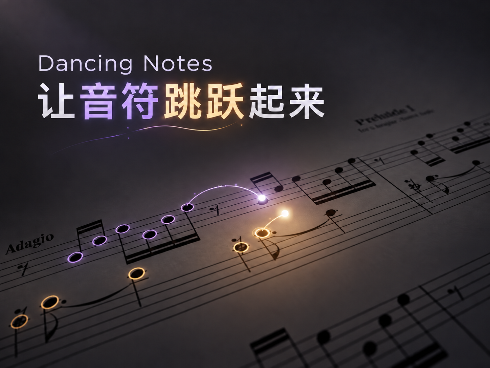

[简体中文](README.md) | **English**



# Dancing Notes · 跳跃的音符

Create 3D sheet-music animations with glowing balls that bounce continuously between real noteheads, accompanied by rings, trails, colored light on the score, and depth of field.

Start with a piece title or existing materials. Your agent checks the project folder, finds missing scores, verifies that MIDI and audio match, and builds the animation using the bundled template.

**Language note:** The skill instructions, reference guides, and template documentation remain in Chinese. This README is an English guide; it does not translate the installed skill itself.

## Demo

[Watch / download the sample video: dancing-notes-sample.mp4](examples/dancing-notes-sample.mp4)

1920 × 1080 · 30 fps · approximately 10 seconds · approximately 5.4 MB, with audio.

The sample video was created by 言说新事 with AI assistance; the cover was originally created by 言说新事. Demo piece: **Bach — Prelude and Fugue in C major, BWV 846**. Score, MIDI and MusicXML source: [Scorebase #5956](https://scorebase.org/scores/5956). Audio can be synthesized programmatically from the score data. The source score, MIDI, MusicXML and standalone audio are not bundled.

This video demonstrates the visual effect. It is not a runtime asset for new pieces. Each new piece needs its own timing, notehead coordinates, and camera path; the demo cannot replace score or audio data.

## Getting started

Add the complete repository folder as the `dancing-notes` skill in a skill location supported by your agent, then enable it using that tool's installation procedure. Preserve the relative locations of `SKILL.md`, `assets/`, `scripts/`, and `references/`; do not install only SKILL.md. `agents/openai.yaml` provides optional interface metadata. The core workflow does not depend on a particular provider.

After the official repository is published, install with the [Skills CLI](https://skills.sh/docs/cli), then select your agent:

```bash
npx skills add SyanChen7/dancing-notes
```

For the release ZIP, extract it first: `unzip dancing-notes.zip`. The resulting `dancing-notes/` folder is the complete skill; it contains `SKILL.md` at its root. Ask your agent to read that file, or copy the whole folder into its supported skills directory.

Example request:

> Use Dancing Notes to create a glowing-ball sheet-music animation for [piece title]. First check my materials folder, find and download anything missing, and verify that the files match. Then show me a short preview.

You can also ask your agent to read [SKILL.md](SKILL.md) and follow its workflow. Agents differ in their browsing, downloading, tool execution, and rendering capabilities; a suitable execution environment is required.

## What you need

**You can start with just a piece title. You do not need to gather every file in advance.** If you already have a score or recording, provide its folder location and specify the version you want to use.

| Material | How it is obtained |
|---|---|
| MusicXML / MXL or a native MuseScore score | Check local files first; search suitable free sources if missing |
| MIDI | Reuse a matching file, obtain a companion file from the same score version, or generate it from the source score |
| Audio | Reuse an aligned recording or synthesize it from the same score |
| SVG score used in the animation | Generate the notation layout and extract real notehead coordinates with the included tools |
| PDF / score images | Optional references for checking the notation; not required inputs |

If local generation tools are unavailable, the agent first looks for reliable companion downloads from the same source. If installing MuseScore Studio 4 becomes necessary, it explains what is missing and asks for installation approval. See the Chinese guides for [material acquisition](references/acquisition.md) and [materials and audio](references/materials-and-audio.md).

## What's included

```text
dancing-notes/
├── SKILL.md
├── README.md
├── README.en.md
├── LICENSE
├── agents/openai.yaml
├── references/                 # Acquisition, validation, audio, and production guides
├── scripts/create_project.py   # Creates a standalone working project
├── assets/dancing-notes-starter/
│   ├── src/                    # Animation, camera, motion, and data interfaces
│   ├── scripts/                # Engraving, notehead measurement, validation, and rendering
│   └── package.json.template   # Becomes package.json in the working project
└── examples/dancing-notes-sample.mp4
```

The source template is included directly. There is no nested ZIP archive and no dependency on files elsewhere on the author's computer.

## Environment and development

Verified on macOS arm64 with **Node.js 22.18.0 / npm 10.9.3**. Required tools: Python 3 (standard library only for the included parser), FFmpeg/FFprobe, and a Remotion-compatible Chromium browser with WebGL. The template pins Remotion 4.0.518, React 19.2.3, Three.js 0.180.0 and Verovio 6.3.0; `npm install` installs these dependencies. Windows/Linux have not been fully tested.

The workflow uses Node.js/npm, Python 3, FFmpeg/FFprobe, and a browser/WebGL environment capable of running Remotion. MuseScore is an optional conversion and synthesis tool, used when needed; it is not required just to start using the skill.

From the skill root, run the following command to copy the template into a new working directory that does not already exist and is not inside another Node project:

```bash
python3 scripts/create_project.py ../my-dancing-notes-project
cd ../my-dancing-notes-project
npm install
npm test
npm run typecheck
```

Then enter the working project, read its README, and install its dependencies. Do not install dependencies or create productions inside the skill's assets directory. For an existing Remotion repository, follow SKILL.md to merge code and dependencies rather than creating a nested project.

The template pins exact dependency versions; all Remotion packages must use the same version. The skill does not bundle node_modules, a browser, sound libraries, or the user's music assets.

## Scope and validation

The default template supports a two-staff piano score on a single SVG surface. Multiple pages, repeats, ornaments, and continuous playing across system breaks require adaptation and verification by the agent. This is not a one-click transcription tool for arbitrary audio.

The visuals come from an existing animation project. The final ZIP has been checked for skill structure, relative paths, relocation, and template copying. An independent 13-note MusicXML/MIDI fixture has passed parsing, mapping, rendering, audio synchronization, and regression tests. The empty starter still needs your piece data before `npm run validate` or `npm run render` can succeed. The current skill has not yet completed an end-to-end new-piece test starting from a title. Each production still requires note-mapping checks, audio synchronization checks, and review of the complete render.

## Author & Original Project

**Dancing Notes** is an original Remotion music visualization project created by **言说新事**.

- **Creator:** 言说新事
- **Official GitHub:** [https://github.com/SyanChen7/dancing-notes](https://github.com/SyanChen7/dancing-notes)
- **Douyin:** [https://v.douyin.com/sJT9y3rtEjU/](https://v.douyin.com/sJT9y3rtEjU/)

**License:** MIT

You are welcome to use, modify, and share this project under the MIT License. Please retain the original copyright and license notices when redistributing the code.

If you create something with this Skill, attribution to the original project is appreciated!

## License

The project's original code, skill documentation, and bundled code template are licensed under the [MIT License](LICENSE), with copyright attributed to **言说新事 (SyanChen7)**.

The sample video, `examples/dancing-notes-sample.mp4`, its music, recording and score content, and the cover image are excluded from the MIT license above. This project grants no separate reuse license for that media. Scores, recordings, and sound libraries obtained by users remain subject to their respective terms.

Third-party dependencies, including Remotion, React, Three.js, and Verovio, retain their own licenses. This project's MIT license does not replace those terms. Dependencies are installed through the package manager and are not bundled in this repository.
